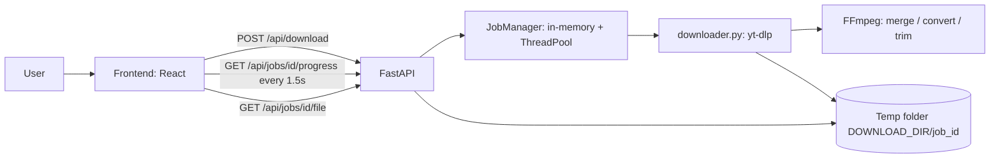

# VYRA — Full Documentation

> **VYRA — Your Media. Your Way.**
> An elegant web interface for downloading video and audio from supported URLs, backed by a real server (FastAPI + yt-dlp + FFmpeg).

*Also available in Arabic: [DOCUMENTATION.md](DOCUMENTATION.md)*

**Important:** Use VYRA only for content you have the right to download, and respect the source platform's terms and copyright. The project does not bypass DRM, logins, or private/paid content, and it is not affiliated with any platform (including YouTube).

---

## 1. Overview

VYRA consists of two separate parts:

| Part | Tech | Role |
|---|---|---|
| **Frontend** (`frontend/`) | React + Vite + TypeScript + Tailwind + Lucide | UI: URL input, settings, progress, history |
| **Backend** (`backend/`) | Python + FastAPI + yt-dlp + FFmpeg | Downloading, converting, trimming, serving the file |

Both can also be bundled into a single Windows program (`VYRA.exe`). See section 10.

## 2. Features

- **Video** downloads at 360p / 480p / 720p / 1080p / 1440p / best available (MP4 preferred).
- **Audio-only** downloads as MP3, WAV, AAC, FLAC, OGG or M4A (real conversion with FFmpeg).
- **Trimming** on the server: seconds, `MM:SS` or `HH:MM:SS`.
- **Playlists**: a single item, the whole playlist, or a range of items.
- **Subtitles**: SRT or VTT, any language via a custom language-code field, when the source provides them.
- **Real progress** reported by the server (percentage, speed, ETA, file name).
- **Download history** stored in your browser only.
- Responsive Brown & Beige UI with accessibility support (labels, aria, focus styles, reduced motion).

## 3. Architecture



**Request flow:**
1. The frontend validates the input, then sends `POST /api/download`.
2. The backend validates the URL (SSRF protection), trimming settings and playlist range, and creates a job with a random 32-character ID.
3. The job runs in a thread pool (limited number of concurrent downloads).
4. The frontend polls for progress every 1.5 seconds and stops at a final state.
5. Only after the download finishes **and the output file is confirmed to exist** does the status become `completed` and the download button appear. 100% is never shown before that.
6. Temporary files are deleted after the retention period (default: 1 hour).

## 4. Project structure

```
VYRA/
├── backend/
│   ├── app/
│   │   ├── main.py          # API endpoints and request models
│   │   ├── config.py        # Reads environment variables
│   │   ├── validation.py    # URL (SSRF) and time-format validation
│   │   ├── jobs.py          # Job + JobManager + periodic cleanup
│   │   └── downloader.py    # yt-dlp: info + job execution + error mapping
│   ├── launcher.py          # Entry point of the .exe build
│   ├── requirements.txt
│   ├── Dockerfile
│   ├── render.yaml
│   └── .env.example
├── frontend/
│   ├── src/
│   │   ├── App.tsx
│   │   ├── api.ts           # API calls and error-message mapping
│   │   ├── config.ts        # Backend URL (single place)
│   │   └── components/
│   │       ├── Downloader.tsx   # Form + progress + history
│   │       └── Sections.tsx     # Navbar, Hero, Features, FAQ, Footer
│   ├── public/favicon.svg
│   └── .env.example / .env.development / .env.production / .env.desktop
├── docs/
│   ├── DOCUMENTATION.md       # Arabic
│   └── DOCUMENTATION.en.md    # English
├── .github/workflows/deploy.yml   # Deploys the frontend to GitHub Pages
├── build_exe.bat                  # Builds VYRA.exe on Windows
└── README.md
```

## 5. Prerequisites

- **Node.js 20 LTS** (frontend)
- **Python 3.11+** (backend)
- **FFmpeg** (on Windows: `winget install Gyan.FFmpeg`, then reopen PowerShell)
- **Git** (to push to GitHub)

## 6. Local development (Windows PowerShell)

**Backend:**
```powershell
cd backend
python -m venv venv
.\venv\Scripts\Activate.ps1
pip install -r requirements.txt
$env:DOWNLOAD_DIR = "$env:TEMP\vyra_downloads"
uvicorn app.main:app --reload --port 8000
```
- If PowerShell blocks scripts: `Set-ExecutionPolicy -Scope Process -ExecutionPolicy Bypass`, then run `Activate.ps1` again.
- Test: http://localhost:8000/health (expect `status: ok` and `ffmpeg: true`), then http://localhost:8000/docs (interactive API page).

**Frontend** (in a new PowerShell window):
```powershell
cd frontend
npm install
npm run dev
```
Then open http://localhost:5173

## 7. Environment variables

### Backend (`backend/.env.example`)
| Variable | Default | Meaning |
|---|---|---|
| `PORT` | `8000` | Port (platforms such as Render/Railway set it automatically) |
| `CORS_ORIGINS` | `http://localhost:5173` | Allowed frontend origins, comma-separated with no spaces, **lowercase, no trailing `/`** |
| `DOWNLOAD_DIR` | `/tmp/vyra_downloads` | Temporary file folder (set it manually on Windows) |
| `MAX_CONCURRENT_DOWNLOADS` | `2` | Number of simultaneous downloads |
| `MAX_DOWNLOAD_SIZE` | `524288000` (500 MB) | Maximum file size in bytes |
| `JOB_RETENTION_HOURS` | `1` | How long files are kept before deletion |

### Frontend
| Variable | Meaning |
|---|---|
| `VITE_API_BASE_URL` | Backend URL (no trailing `/`). **Undefined** = `http://localhost:8000`. **Empty** = same origin (used by the .exe build). |

> `VITE_` variables are baked into the site at build time, so rebuild/redeploy the frontend after changing them.

## 8. API reference

All responses are JSON. Interactive docs: `/docs`.

| Method | Path | Description | Status codes |
|---|---|---|---|
| GET | `/health` | Service status, FFmpeg presence, yt-dlp version | 200 |
| POST | `/api/info` | Link info (title, thumbnail, duration, playlist, qualities, subtitle languages) | 200 / 400 / 422 |
| POST | `/api/download` | Create a job | 202 / 422 / 429 |
| GET | `/api/jobs` | Last 50 jobs | 200 |
| GET | `/api/jobs/{id}` | Job details | 200 / 404 |
| GET | `/api/jobs/{id}/progress` | Current progress | 200 / 404 |
| GET | `/api/jobs/{id}/file` | Download the final file (streamed) | 200 / 404 / 409 (not ready) / 410 (expired) |
| DELETE | `/api/jobs/{id}` | Cancel a running job, or delete a finished job and its files | 200 / 404 |

### `POST /api/download` body
```json
{
  "url": "https://example.com/video",
  "mode": "video",
  "quality": "720",
  "audio_format": "mp3",
  "trim_enabled": false,
  "trim_start": null,
  "trim_end": null,
  "subtitles": false,
  "subtitle_lang": "en",
  "subtitle_format": "srt",
  "playlist_mode": "single",
  "playlist_start": 1,
  "playlist_end": 10
}
```
| Field | Allowed values |
|---|---|
| `mode` | `video` / `audio` |
| `quality` | `360` `480` `720` `1080` `1440` `best` |
| `audio_format` | `mp3` `wav` `aac` `flac` `ogg` `m4a` |
| `trim_start` / `trim_end` | Seconds, `MM:SS` or `HH:MM:SS` (`trim_start` required when trimming is enabled, `trim_end` optional) |
| `subtitle_lang` | Language code such as `en`, `ar`, `pt-BR` |
| `subtitle_format` | `srt` / `vtt` |
| `playlist_mode` | `single` / `all` / `range` |

**Response:** `{"job_id": "…", "status": "waiting"}`

### `GET /api/jobs/{id}/progress` response
```json
{
  "id": "…", "status": "downloading", "percent": 42.5,
  "speed": 2100000, "eta": 18, "downloaded_bytes": 8400000,
  "filename": "Title [id].mp4", "item_index": null, "item_total": null,
  "completed_items": 0, "failed_items": 0, "actual_quality": "720p",
  "notes": [], "error": null, "file_size": null,
  "file_ready": false, "created_at": 0, "finished_at": null
}
```
**Statuses:** `waiting` → `fetching` → `downloading` → `processing` → `converting`/`cutting` → `finalizing` → `completed`, or `failed` / `cancelled`.

**Quality selection:** the best video not exceeding the requested quality is chosen. If none exists, the closest available alternative is used, and `actual_quality` reports the real height that was downloaded.

## 9. Code walkthrough

### Backend
- **`validation.py`**
  - `validate_public_url`: accepts http/https only, rejects localhost, `.local`, `.internal` and metadata hosts, then resolves DNS and rejects any non-public IP (private, loopback, link-local, reserved).
  - `parse_time`: accepts seconds, `MM:SS` or `HH:MM:SS`; rejects other formats and negative values.
- **`jobs.py`**: `Job` (a dataclass holding status, progress, error, file and a cancel flag) and `JobManager` (in-memory dict + lock + `ThreadPoolExecutor`). `job_dir` prevents escaping `DOWNLOAD_DIR`. `cleanup_loop` runs every 5 minutes and deletes finished jobs after the retention period.
- **`downloader.py`**
  - `fetch_info`: extracts metadata without downloading.
  - `_build_opts`: builds the yt-dlp options (quality, audio conversion, subtitles, trimming, playlist range, size limit, timeout).
  - `run_job`: runs the download with progress and cancel hooks, then verifies the output exists, zips multiple files, and sets `completed` only after that.
  - `_friendly`: maps yt-dlp errors to readable messages (private, removed, unsupported, FFmpeg, too large). Tracebacks go to the server log only and never reach the user.
- **`main.py`**: endpoints, the `DownloadRequest` Pydantic model with validation, and CORS setup. In .exe mode it also serves the frontend files.

### Frontend
- **`config.ts`**: the only place that defines the backend URL.
- **`api.ts`**: `fetch` wrappers, a clear message when the server is unreachable, and conversion of FastAPI validation errors into readable text.
- **`Downloader.tsx`**: validates the URL, trimming and playlist range before sending; polls every 1.5 s and stops at a final state and on unmount; history lives in `localStorage` (key `vyra_history`, up to 30 entries).
- **`Sections.tsx`**: sticky Navbar with a mobile menu, Hero, Features, FAQ accordion, and a Footer with the legal disclaimer.

## 10. Windows build (`VYRA.exe`)

Idea: one program that runs the backend, serves the frontend, and opens your browser at `http://127.0.0.1:8000`, with FFmpeg bundled inside.

**Build:**
1. Install Node.js and Python (tick *Add Python to PATH*).
2. Put the project in a simple path without spaces (e.g. `C:\VYRA`).
3. Double-click `build_exe.bat` and wait for `DONE`.
4. Output: `dist\VYRA.exe`.

**What the script does:** `npm run build:desktop` (frontend with no backend URL, i.e. same origin) → downloads FFmpeg → creates a Python environment → runs PyInstaller with `--onefile`.

**Notes:** keep the black console window open; closing it stops the program. Windows SmartScreen or antivirus may warn because the file is not code-signed. FFmpeg is GPL-licensed, so mention that when distributing.

## 11. Deployment

### Frontend (choose one)
**Vercel:** import the repo, set **Root Directory = `frontend`**, preset Vite, add `VITE_API_BASE_URL` with your backend URL, then deploy. Set `CORS_ORIGINS` on the backend to match your main Vercel URL (preview URLs have different addresses and will be rejected by CORS).

**GitHub Pages:** enable Settings → Pages → Source: **GitHub Actions**, and add the variable `VITE_API_BASE_URL` under Settings → Secrets and variables → Actions → Variables. The workflow in `.github/workflows/deploy.yml` builds `frontend/` and sets `base` to `/repo-name/` automatically.

### Backend
The project ships with a `Dockerfile` (installs FFmpeg and honors `PORT`) and `render.yaml`. It can run on any platform that supports Docker (Render, Railway, Koyeb, a VPS, …) with `CORS_ORIGINS` set. On Render: Runtime = Docker, Root Directory = `backend`, then open `/health` to verify.

**Notes for free hosting (check each platform's current terms, they change):**
- Free services often **sleep** when idle; the first request can take about a minute.
- Files are **temporary** and lost on restart; in-memory jobs are lost too.
- Low CPU/RAM can make conversions slow or fail.
- Some sites (YouTube in particular) may block hosting-provider IP addresses. This is not a code bug. Running locally (or the .exe) usually avoids it.

## 12. Security

**Implemented:**
- SSRF check on the URL (allowed schemes, blocks localhost, private addresses and metadata hosts after DNS resolution).
- No shell commands: yt-dlp is called as a Python library.
- File names are sanitized by yt-dlp; each job has its own folder, with a check that prevents leaving the download directory.
- Unguessable random job IDs (32 characters), validated against a strict pattern.
- Limits on concurrent downloads and file size, plus a network timeout.
- CORS restricted to an environment-defined origin list (no `*`).
- Automatic deletion of old files; server paths and internal errors are not exposed to the user.
- No bypass of DRM, authentication or private content.

**Not implemented yet (important if you expose the service publicly):**
- No authentication; anyone with the URL can use the API.
- No rate limiting.
- The SSRF check runs on the original URL at request time; it does not re-check redirects or later DNS changes.

## 13. Known limitations

- **The code had not been fully run end-to-end when this was written**, and there are no automated tests yet (only a syntax check of the backend). Please report any bug you find.
- Jobs are in memory and are lost on restart (the logic is isolated in `jobs.py` so it can be upgraded to Redis).
- The failed-items counter (`failed_items`) and per-item playlist status are not tracked in detail; failed items are simply skipped and successful files are counted.
- The `cutting` status may not appear during trimming; you will usually see `downloading` or `converting`.
- There is no dedicated subtitles endpoint; subtitle files arrive with the final file (or inside the ZIP).
- Some qualities or subtitles may not exist depending on the source.
- History is browser-only, and files deleted from the server show an "expired" message.

## 14. Troubleshooting

| Problem | Fix |
|---|---|
| `Cannot reach the VYRA server` | The server is stopped or asleep (wait a minute), `VITE_API_BASE_URL` is wrong, or `CORS_ORIGINS` doesn't exactly match the frontend URL |
| `/health` shows `ffmpeg: false` | Install FFmpeg and reopen PowerShell, or use Docker (the Dockerfile installs it) |
| `Activate.ps1` blocked | `Set-ExecutionPolicy -Scope Process -ExecutionPolicy Bypass` |
| Download fails with "unsupported" or "private" | The link is unsupported, or the content is private or requires login (it cannot be downloaded) |
| Fails on YouTube from a hosted server | Likely an IP block on hosting providers; try running locally |
| 410 "File expired" | The retention period passed; download again |
| `build_exe.bat` fails | Copy the last lines of the console and look for `[ERROR]`; make sure Node, Python and PATH are set up |
| "Windows protected your PC" | More info → Run anyway (the file is unsigned) |
| Blank page on GitHub Pages | Check `VITE_BASE` (set by the workflow) and that Source is set to GitHub Actions |
| Updating yt-dlp | Sites change constantly; run `pip install -U yt-dlp` or rebuild the Docker image |

## 15. Suggested roadmap

Automated tests (pytest + a mocked downloader) · detailed per-item playlist status · subtitles endpoint · rate limiting and optional authentication · Redis-backed jobs · redirect re-validation · Server-Sent Events instead of polling.

## 16. Disclaimer

Users are responsible for ensuring they have the right to download content and for respecting the source platform's terms and copyright. VYRA does not circumvent any content protection and is not affiliated with any platform. The project is provided "as is" without warranty.
